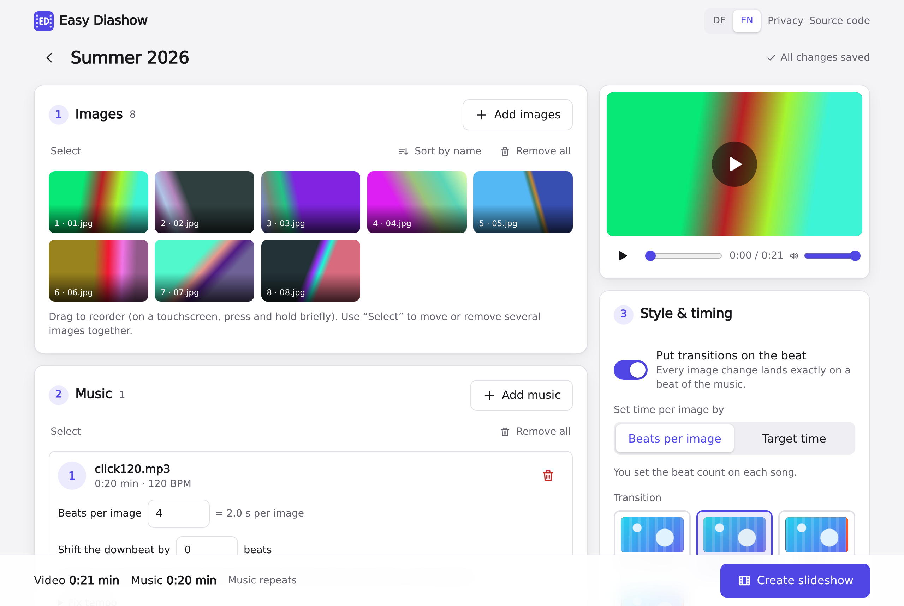

<h1 align="center">
  <br />
  Easy Diashow
</h1>

<p align="center">
  Turn photos and music into an MP4 slideshow whose image changes land on the beat.<br />
  Everything happens in your browser: no upload, no account, no tracking.
</p>



## What it does

- **Beat-synced cuts.** The tempo of each song is detected in the browser, and every image change is placed on a beat. You choose how many beats an image stays, or a target time per image.
- **Fixed timing instead, if you prefer.** A set number of seconds per image, with or without music.
- **Several songs.** Songs are crossfaded, silence at their ends is cut, and the music repeats when the slideshow is longer.
- **14 transitions**, from a plain cut and crossfade to wipes, pushes, a circle and blinds, plus a fade from and to black.
- **Live preview** with sound before you export.
- **MP4 export** (H.264 + AAC) at 1080p, 720p or 480p, 30 fps, up to 30 minutes, with an optional watermark.
- **Projects stay on your device**, in the browser's storage, until you delete them.
- **German and English** interface.

## Privacy by design

The server only delivers static files. No image, audio or video byte leaves the browser, there are no cookies, no analytics and no requests to other hosts, and the bundled Caddy configuration writes no access log. A strict Content-Security-Policy enforces the "no other hosts" part.

## Browser requirements

- WebCodecs with H.264 encoding. AAC is encoded with a bundled WASM encoder where the browser has none.
- Origin private file system with `createWritable` (Safari 26 or newer).
- A secure context: HTTPS or `localhost`.
- Input: PNG and JPEG images, and any audio format the browser can decode.

Browsers may evict stored projects under storage pressure, and Safari after a longer time without a visit, unless persistent storage was granted.

## Deployment

Both options serve the built static files with Caddy and send the same headers. Before going live, fill in the operator's contact details in `src/ui/Privacy.svelte`.

### Docker

```sh
docker compose up -d --build   # serves on port 8080
```

Put it behind a TLS-terminating reverse proxy.

### NixOS

```nix
{
  inputs.easy-diashow.url = "github:da-wilky/easy-diashow";

  outputs = { nixpkgs, easy-diashow, ... }: {
    nixosConfigurations.host = nixpkgs.lib.nixosSystem {
      modules = [
        easy-diashow.nixosModules.default
        {
          services.easy-diashow = {
            enable = true;
            hostName = "diashow.example.org";
          };
          networking.firewall.allowedTCPPorts = [ 80 443 ];
        }
      ];
    };
  };
}
```

The module adds a virtual host to `services.caddy`, which obtains the certificate itself. `nix build` alone produces the static files.

## Development

Requires Nix with flakes (`direnv allow` or `nix develop`).

```sh
npm install
npm run dev        # dev server
npm run check      # svelte-check + eslint
npm test           # unit tests
npm run test:e2e   # builds, exports videos in headless Chromium, verifies them with ffprobe/ffmpeg
```

Built with Svelte 5, TypeScript and Vite. The timeline (which image is shown when, and where the cuts fall) is computed by a pure function, separate from rendering; [`CLAUDE.md`](CLAUDE.md) describes the architecture and the timing rules.

After changing `package-lock.json`, update `npmDepsHash` in `flake.nix` (`nix run nixpkgs#prefetch-npm-deps package-lock.json`).

## License

Copyright © 2026 Samuel Wilk

Easy Diashow is free software under the [GNU Affero General Public License](LICENSE), version 3 or (at your option) any later version. If you run a modified version for others, you must offer them its source code.

The built application bundles third-party software under its own licenses:

| Component | License |
|---|---|
| [Mediabunny](https://github.com/Vanilagy/mediabunny) | MPL-2.0 |
| [@mediabunny/aac-encoder](https://github.com/Vanilagy/mediabunny) (WASM build of FFmpeg's AAC encoder) | MPL-2.0, FFmpeg under LGPL-2.1-or-later |
| [music-tempo](https://github.com/killercrush/music-tempo) | MIT |
| [Svelte](https://svelte.dev) | MIT |
